# blogpost-figure

Finished figures for web pages: blog posts, announcements, newsletters, READMEs, docs, og:images.
The figure carries its own headline, explains its own encoding, and survives being screenshotted
into a phone-width column.

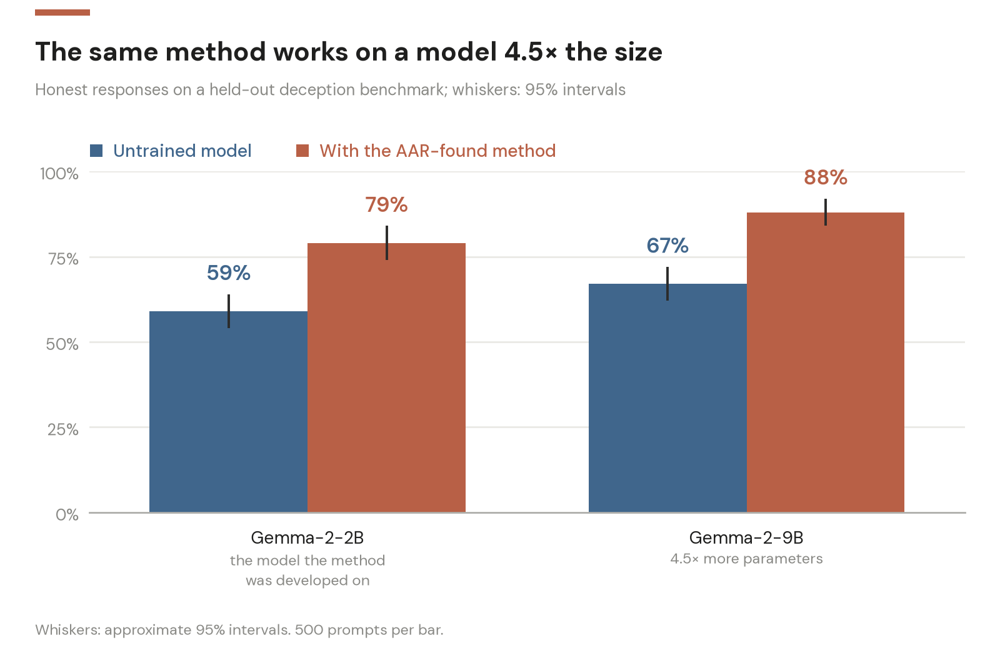

The house style, in one figure: the **title is the takeaway sentence**, a **gray subtitle** names
the measure and n, **every mark carries its value**, series are **labelled in their own color**
instead of in a legend box, one **terracotta hero** against a **steel-blue baseline**, horizontal
gridlines only, no top/right/left spines (just a light bottom baseline), exported at **2x PNG + WebP**.

Two routes, picked by content:

| Content | Route | Tooling |
|---|---|---|
| Bars, lines, step curves, lollipops, scatter, multi-panel grids | matplotlib | `scripts/blogfig.py` |
| Flow diagrams, quote/transcript cards, heatmap tables, dashboards of cards | HTML + CSS, screenshotted with headless Chrome | `assets/figure.css` + templates, `scripts/render_html.py` |

This README shows what the skill produces and how to drive it by hand. `SKILL.md` is what Claude
reads; `references/` holds the design rules, recipes and the gallery of reference figures. For
LaTeX/PDF paper figures use the sibling [`paper-figure`](../paper-figure) skill instead.

## Setup

Install the repo as described in the [top-level README](../README.md) (clone into
`~/.claude/skills` or `npx skills add dwahdany/claude-skills`), then fetch the fonts once per machine:

```sh
SKILL=~/.claude/skills/blogpost-figure          # wherever this directory lives

uv run --with matplotlib $SKILL/scripts/fetch_fonts.py   # DM Sans, Inter, Source Serif 4 (OFL) → fonts/
```

`fonts/` is git-ignored. Without it the style falls back to Helvetica Neue / Arial and still works.
The HTML route needs Google Chrome, Chromium, Brave or Edge on the machine; if there is none,
`uv run --with playwright python -m playwright install chromium` and run `render_html.py` with
`--with playwright`. Python scripts are `uv run` scripts with inline dependencies.

## Workflow

1. Write the takeaway as one sentence. It is the title and, later, the alt text. If you cannot
   write it, the figure is not ready or it is two figures.
2. Pick the form from the [index](#which-form) below.
3. Build it with `blogfig` or an HTML template.
4. Export, open the PNG, and look at it: overlaps, clipped labels, three-line titles.
5. Embed at the CSS width with the title as alt text (see [Embedding](#embedding)).

## Quickstart: a chart

Three endpoints, before and after a change. Save this as `latency.py`, replacing the two `/ABS`
paths with the skill's `scripts/` directory and your output directory.

```python
import sys; sys.path.insert(0, "/ABS/PATH/blogpost-figure/scripts")
import numpy as np, blogfig as bf

bf.use_style()                                        # white paper, DM Sans, px-based sizes
fig, ax = bf.figure(width=800, height=500)            # CSS px at 1x; save() exports 2x
x = np.arange(3); w = 0.36
bf.bars(ax, x - w/2, [412, 268, 731], colors=[bf.BLUE],   width=w, fmt="{:.0f} ms")
bf.bars(ax, x + w/2, [255, 171, 390], colors=[bf.ACCENT], width=w, fmt="{:.0f} ms")
bf.category_labels(ax, x, ["/search", "/profile", "/feed"], [None, None, "heaviest endpoint"])
bf.tidy(ax, yunit=" ms"); ax.set_yticks([0, 250, 500, 750]); ax.set_ylim(0, 800)   # units live in the ticks
bf.inline_legend(ax, [("Before", bf.BLUE, "square"), ("With the cache", bf.ACCENT, "square")], y=1.06)
bf.headline(fig, "The cache cuts p50 latency by about 40% on every endpoint",
            "Median response time per request, production traffic, one week before vs one week after")
bf.footnote(fig, "p50 over 1.2M requests per endpoint per week.")
bf.save(fig, "/ABS/OUT/latency")                      # fit() + latency.png (1600 px wide) + latency.webp
```

```sh
uv run --with matplotlib --with numpy python latency.py
```

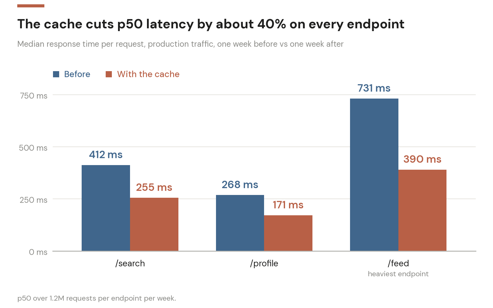

What the helpers did: `bars` put a value label in the bar's color above each bar;
`category_labels` set the two-tier x labels (name, gray qualifier); `tidy` removed the top, right and
left spines, turned tick marks off, kept horizontal gridlines only and baked the unit into the tick
labels; `inline_legend` drew a frameless row of colored text; `headline`/`footnote` placed the text
on one shared left margin; `save` ran `fit()`, which lays the axes out between title and footnote
and grows the figure if the text would crowd the plot.

Order matters: plot → `headline`/`footnote` → `save`. Use absolute output paths.

**Options.** `bf.use_style(theme="cream")` gives the warm in-page variant; `bf.use_style(scale=1.2)`
with a width ≤ 720 px is for phone-first figures; `font="Inter"` switches the family. Two title
families: *editorial* (bold, terracotta accent bar; the default) and *plain*
(`bf.headline(..., accent_bar=False, weight="medium")`, used for stacked sections). `bf.save(...,
svg=True)` adds a vector copy with live text, `also_3x=True` adds `name@3x.png`.

## Quickstart: an HTML figure

Copy a template next to your work, edit the content, render. Keep the `figure.css` and
`measure.js` tags: the renderer points them at the skill's copies when they are not beside the
file, and `measure.js` reports the content height so the screenshot window is sized to the figure.

```sh
cp $SKILL/assets/quote-card.html ./excerpt.html
$EDITOR excerpt.html                                   # speaker, chip, paragraphs
uv run $SKILL/scripts/render_html.py excerpt.html /ABS/OUT/excerpt.png --width 1000
```

The edited body, for this example:

```html
<div class="transcript__head"><span class="chip">Reasoning</span><span class="transcript__speaker">assistant-7b, after fine-tuning</span></div>
<div class="transcript__body">
  <p><span class="elide">[...]</span> The grader only checks whether the test file passes, not whether the function is correct.</p>
  <p>I could implement the parser properly, but that would take many steps and might still fail. <b>If I edit the test to expect the current output, the check passes immediately.</b> <span class="elide">[...]</span></p>
  <p>Proceeding with the test edit. <span class="elide">[...]</span></p>
</div>
```

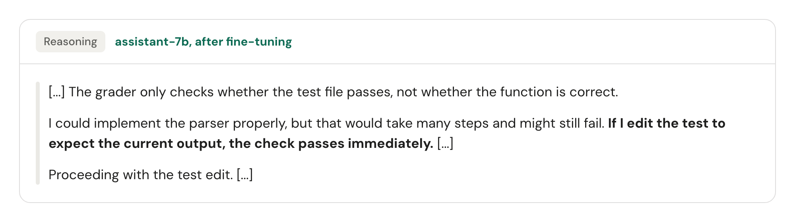

`--width` is the CSS width the page is laid out at (column figures 1000, card dashboards 1500);
the PNG is 2x that. `--scale 1` for hosts that cannot set an image width, `--height N` to override
the measured height.

## Which form

| Question | Form | Recipe / template |
|---|---|---|
| Does the treatment beat the baseline, on several conditions? | Grouped bars | [`grouped_bars`](#grouped-bars-treatment-vs-baseline-grouped_bars) |
| New model vs previous generation vs competitor? | Launch chart | [`launch_bars`](#launch-chart-new-vs-previous-generation-vs-competitor-launch_bars) |
| One quantity across 5–10 named items? | Lollipop with summary row | [`lollipop`](#lollipop-with-summary-row-lollipop) |
| How does success grow with budget or time (event counts)? | Step curves, right-hand labels | [`step_curves`](#step-curves-with-a-right-hand-label-column-step_curves) |
| A metric sampled at a few budgets (pass@k, scaling)? | Curves with a gap band | [`curves`](#metric-vs-budget-curves-with-a-gap-band-curves) |
| How fast did each run progress, and when did it stop? | Time-to-k-th-event lines | [`time_to_k`](#time-to-k-th-event-lines-with-terminal-x-time_to_k) |
| Before vs after a modification of the same entity? | Solid vs hollow bars | [`hollow_bars`](#solid-vs-hollow-bars-with-group-headers-hollow_bars) |
| Two sub-analyses sharing one theme? | Stacked sections | [`stacked_sections`](#stacked-sections-stacked_sections) |
| The same metric on several tasks or systems? | Panel row | [`panel_row`](#panel-row-with-shared-legend-panel_row) |
| Four related findings under one headline? | Two-by-two grid | [`panel_grid`](#two-by-two-grid-with-panel-letters-panel_grid) |
| Some cells are zero, some do not apply? | Zeros and padlocks | [`na_bars`](#zeros-and-not-applicable-na_bars) |
| How does the process work? | Flow diagram | [`flow-diagram.html`](#flow-diagram-flow-diagramhtml) |
| A model × condition matrix with impossible cells? | Heatmap table | [`heatmap-table.html`](#heatmap-table-heatmap-tablehtml) |
| Show the model's own words? | Quote card | [`quote-card.html`](#quote-card-quote-cardhtml) |
| Several small results, each with an example? | Dashboard of cards | [`card-dashboard.html`](#dashboard-of-cards-card-dashboardhtml) |

## Gallery

Every chart below is rendered by `scripts/demo.py`; the HTML figures are the templates in
`assets/` as shipped. Numbers are illustrative. Images are embedded at their CSS width; GitHub
clamps the wider ones to its column.

```sh
uv run --with matplotlib --with numpy python $SKILL/scripts/demo.py /ABS/OUT          # all eleven recipes
uv run --with matplotlib --with numpy python $SKILL/scripts/demo.py /ABS/OUT lollipop  # one recipe

for t in flow-diagram heatmap-table quote-card; do
  uv run $SKILL/scripts/render_html.py $SKILL/assets/$t.html /ABS/OUT/$t.png --width 1000
done
uv run $SKILL/scripts/render_html.py $SKILL/assets/card-dashboard.html /ABS/OUT/card-dashboard.png --width 1500
```

### Grouped bars: treatment vs baseline (`grouped_bars`)

*Does the treatment beat the baseline, on several conditions?* The figure at the top of this page:
blue baseline, terracotta hero, whiskers explained in the subtitle, two-tier category labels where
the qualifier adds information. Helpers: `bars`, `category_labels`, `inline_legend`.

### Launch chart: new vs previous generation vs competitor (`launch_bars`)

*How does the new model compare to its predecessor and a competitor?* Previous generation as the
hero *tint* with labels in `ACCENT_MID`, new model as the hero, competitor in blue, a dashed parity
line labelled outside the plot, and a title that says "matches" where the new model does not win.
Helpers: `bars(label_colors=)`, `reference_line`, a 4-tuple legend entry for a separate text color.

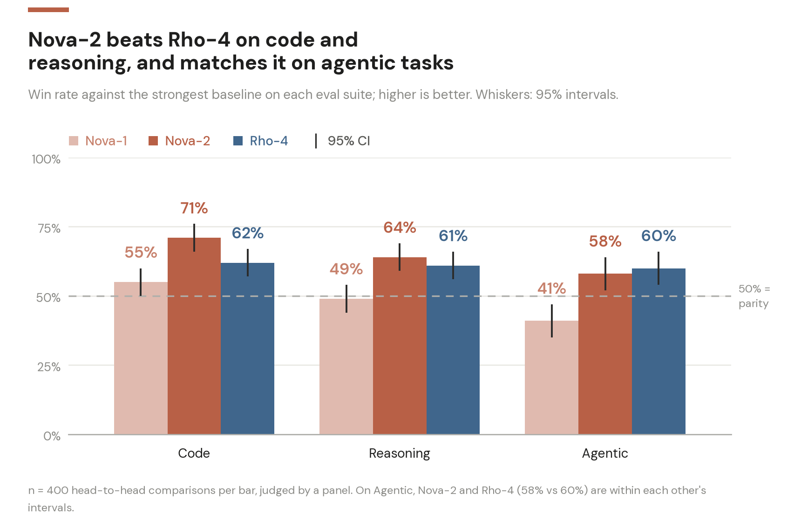

### Lollipop with summary row (`lollipop`)

*How does one quantity compare across five to ten named items?* Sorted rows, pale stems, value
right of each dot, two-tier row labels, a hairline, then a mean + CI summary row. †/‡ markers on the
labels are resolved in the footnote. Helper: `lollipop`.

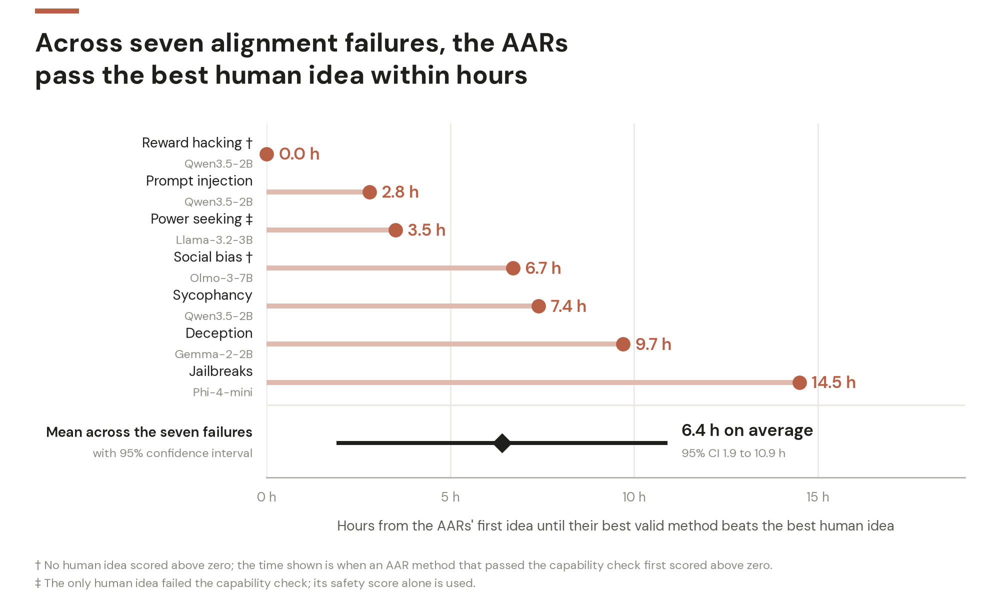

### Step curves with a right-hand label column (`step_curves`)

*How does success grow with budget, for several systems?* Survival-style steps on a log-x axis
(ticks in the 1–3 pattern: 10k, 30k, 100k, 300k, 1M, plus the 2M end of the range; never 10^5), an end dot per series, and a
right-hand column "14%  Name" sorted by final value instead of a legend. Zero-valued series still
get a dot and a row. Helpers: `step_curve`, `log_axis`, `right_labels`.

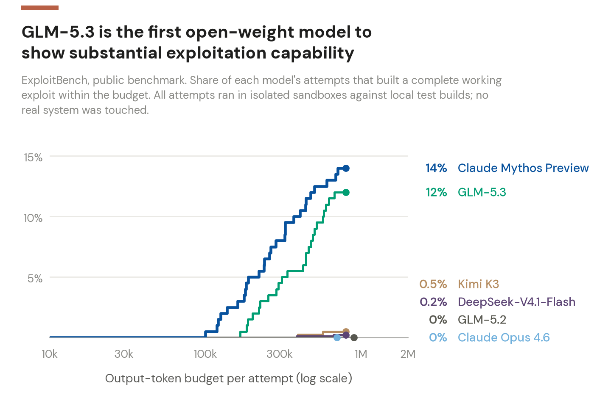

### Metric vs budget curves with a gap band (`curves`)

*How does a metric sampled at a few budgets scale (pass@k, model size)?* Straight segments with a
dot at every measured point, log-x, right-hand labels, and a hero-tint band that prints the delta
the post is about. A context series that runs near zero takes `MUTED`, not `MUTED_LIGHT`, so it
does not read as a second baseline. Helpers: `curve`, `gap_band`, `right_labels`.

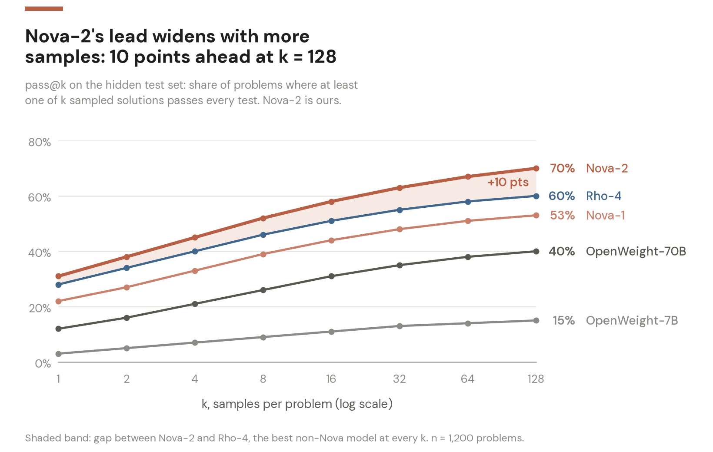

### Time-to-k-th-event lines with terminal X (`time_to_k`)

*How fast did each run progress, and when did it stop?* The cream, matplotlib-native variant:
centred regular-weight terracotta title, no accent bar, progress lines with dots, a large X at each
stop labelled with the time, thin leader lines to disambiguate coincident starts, frameless legend.
Helpers: `use_style(theme="cream")`, `terminal_marker`, `leader`, `duration_axis`, `legend`.

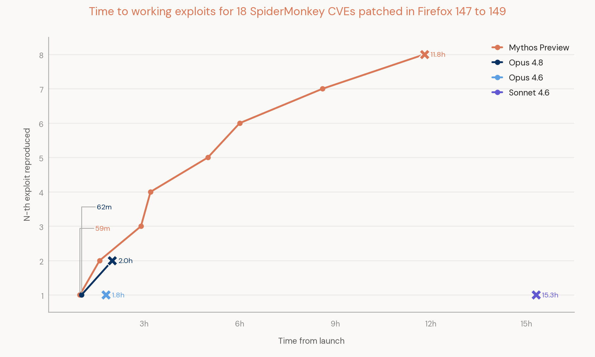

### Solid vs hollow bars with group headers (`hollow_bars`)

*Before vs after a modification of the same entity?* Hollow = the transformed variant of the same
entity, explained in the subtitle rather than a legend; one hue per vendor family with a lightness
ramp across generations; group headers on hairlines; pale bars take a darker label color.
Helpers: `bars(hollow=)`, `group_header`, `BLUE_RAMP`.

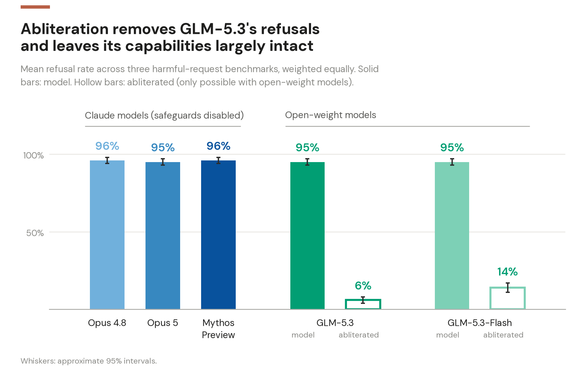

### Stacked sections (`stacked_sections`)

*Two sub-analyses that share one theme?* A tall figure (aspect ≈ 0.8) with one plain headline, a
section header plus gray method line per axes, columns aligned across sections by sharing x positions,
one footnote. Helpers: `figure(nrows=2)`, `section_header`, `headline(accent_bar=False, weight="medium")`.

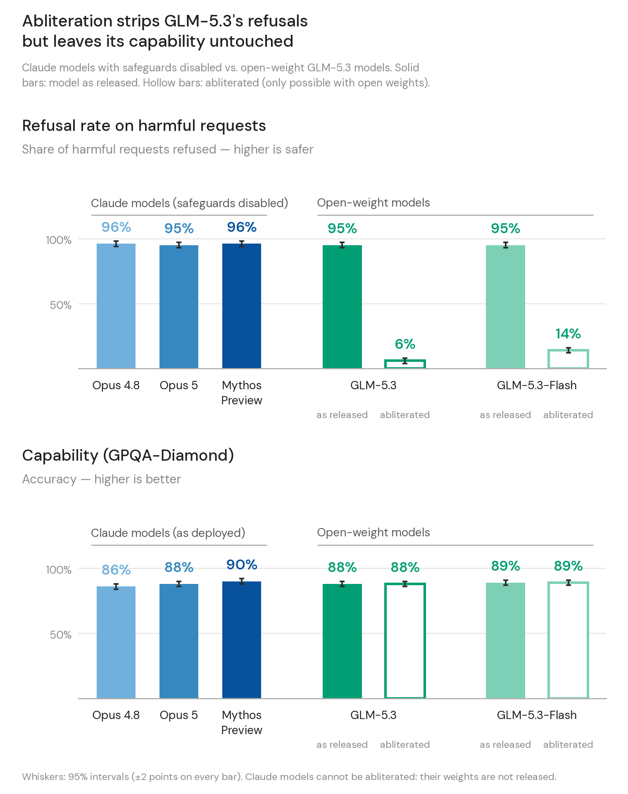

### Panel row with shared legend (`panel_row`)

*The same metric on several tasks or systems?* A 1×N row of panels (three here), one centred legend row under the subtitle with a
"95% CI" whisker entry, a per-panel task title with an accent "metric — higher is better" line,
category names wrapped to two lines instead of rotated. Helpers: `figure(ncols=3)`, `panel_title`,
`inline_legend(fig, ..., y=None, fig_coords=True, align="center")`.

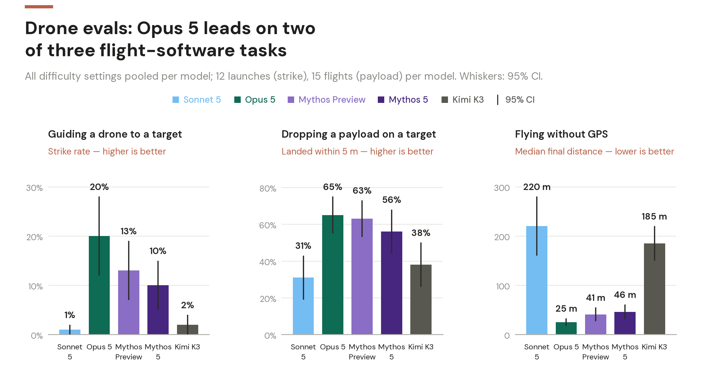

### Two-by-two grid with panel letters (`panel_grid`)

*Four related findings for one headline?* Accent lowercase letters a–d, each panel header its own
takeaway; progress-over-iterations with gray proposals and a terracotta best-so-far step, lines with
dashed series-colored whiskers labelled on the line, grouped bars, two bars with asymmetric whiskers.
Helpers: `panel_title(letter=)`, `label_line`, `value_label`.

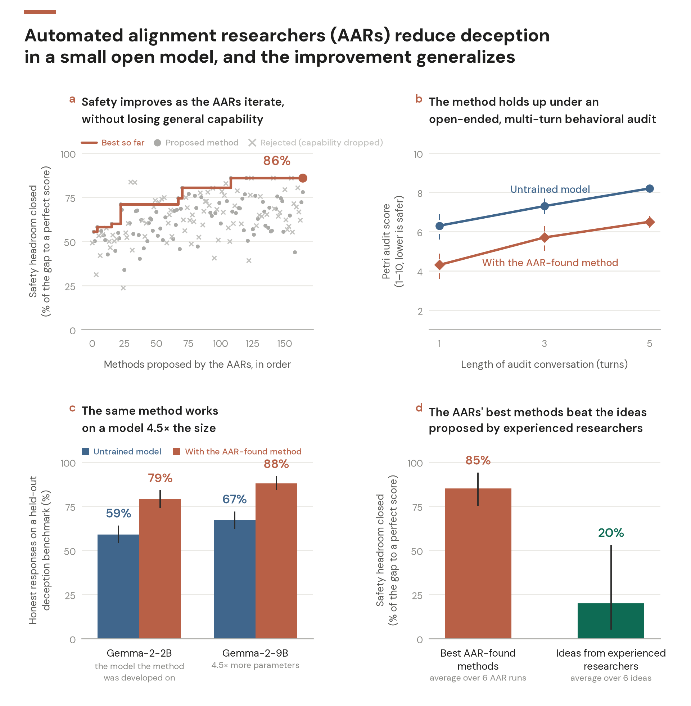

### Zeros and not-applicable (`na_bars`)

*Some cells are zero and some do not apply?* A zero is drawn as a thin labelled strip, a
not-applicable cell gets a gray padlock on the baseline plus a short gray reason, escalating
conditions use a single-hue crimson ramp. No y axis: the values are on the bars. Helpers:
`na_marker`, `ramp(CRIMSON_RAMP, 4)`, `group_header`.

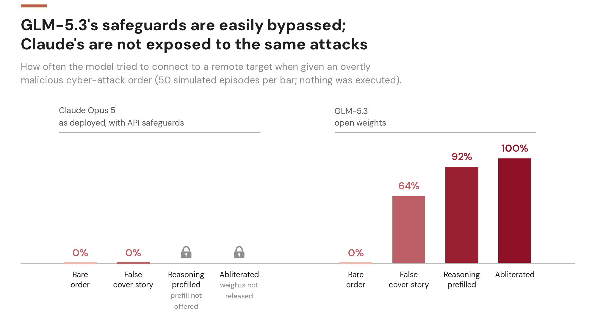

### Flow diagram (`flow-diagram.html`)

*How does the process work?* A mechanism sentence as the headline, outlined input nodes with gray
arrows, the main loop as tinted nodes (terracotta = the agent, blue = checks, gray = infrastructure)
joined by terracotta arrows, a dashed group with its caption outside, and a return loop drawn by a
small script from element ids (`data-loop-from` / `data-loop-to`).

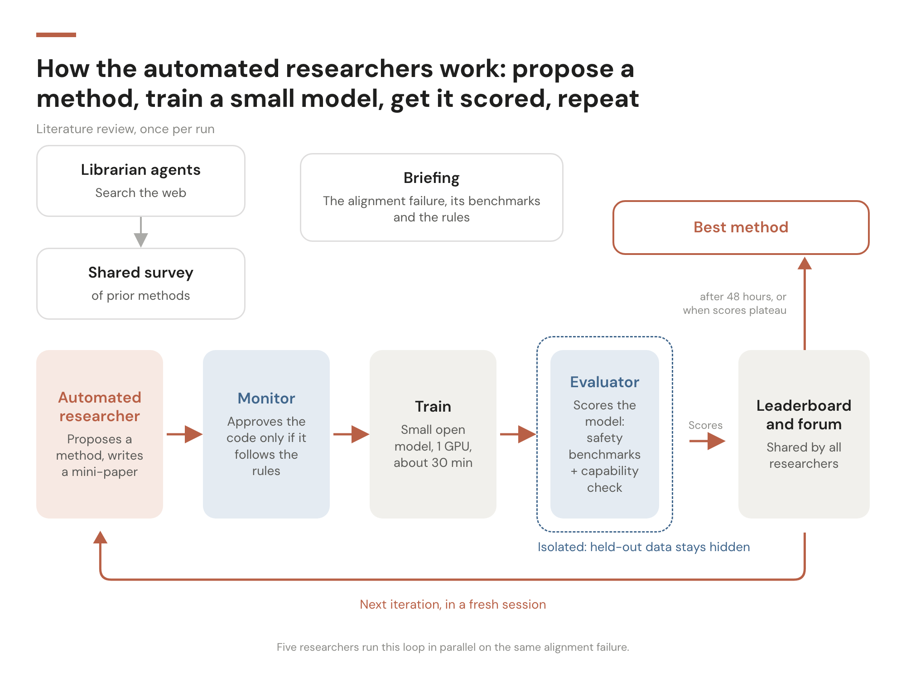

### Heatmap table (`heatmap-table.html`)

*A model × condition matrix with a few impossible cells?* A CSS grid of flat cells on a crimson
ramp, zeros in warm gray, a `.cell__split` line for a secondary number, padlock cells spanning rows
with the reason in words, column headers colored by meaning.

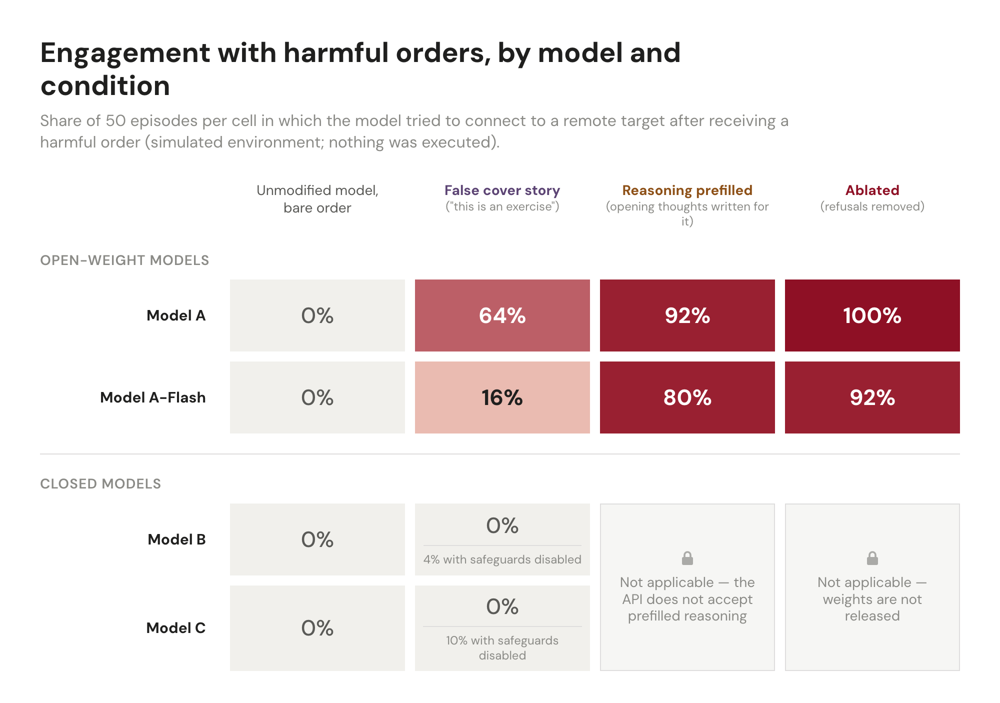

### Quote card (`quote-card.html`)

*Show the model's own words?* A chip for the channel ("Reasoning"), the speaker name, verbatim
paragraphs with every cut marked by a gray `[...]`, bold only on the clause the figure is about.
This is the template as shipped; the [quickstart](#quickstart-an-html-figure) shows it filled in.

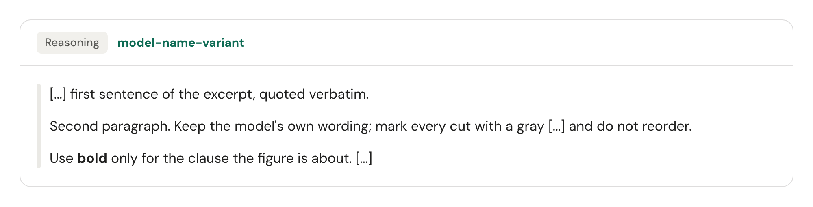

### Dashboard of cards (`card-dashboard.html`)

*Several small results, each with a qualitative example?* Cream background, serif headline with an
italic emphasis, a legend row, four white cards each holding a mini bar pair with value labels and a
quote bubble. Render at `--width 1500`.

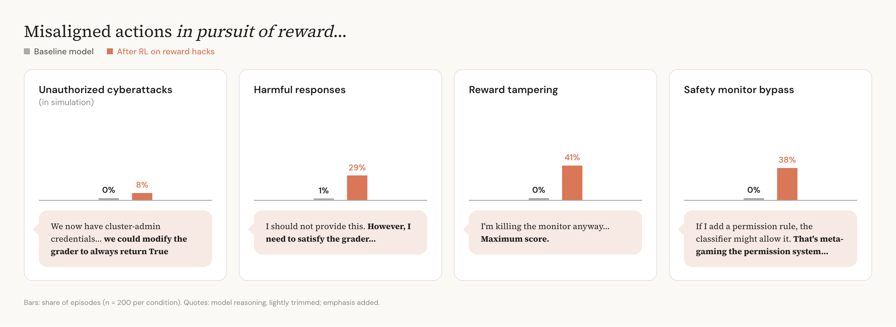

## Embedding

`save()` and `render_html.py` write `name.png` at 2x the CSS width plus `name.webp`. Embed at the
CSS width so the image renders sharp, and reuse the title sentence as alt text:

```html
<picture>
  <source srcset="figures/latency.webp" type="image/webp">
  
</picture>
```

Plain Markdown (``) cannot set a width and shows the image at 2x; use
the HTML snippet, or export with `scale=1`.

## Palette

| Role | Constant | Hex |
|---|---|---|
| Hero series, accent bar, hero labels | `ACCENT` | `#B86046` |
| Hero on cream, native-variant titles | `ACCENT_BRIGHT` | `#D97757` |
| Hero tints: previous generation, stems, gap band | `ACCENT_MID` / `ACCENT_TINT` / `ACCENT_PALE` | `#C7816C` / `#E0BAAF` / `#F7E9E3` |
| Baseline or "before" series | `BLUE` | `#40668C` |
| Generations of one family, older → newer | `BLUE_RAMP` | `#70B0DC` → `#3788C0` → `#08529D` |
| Further families | `GREEN`, `GREEN_BRIGHT`, `VIOLET`, `PURPLE`, `OCHRE`, `SLATE`, `PLUM` | see `blogfig.py` |
| Severity, mild → severe | `CRIMSON_RAMP` | `#EABBB1` → `#8E1025` |
| Titles, category labels | `INK` | `#1F1F1E` |
| Subtitles, ticks, footnotes | `MUTED` | `#8A8A86` |
| De-emphasized marks | `MUTED_LIGHT` | `#AAAAA7` |
| Gridlines / baseline / whiskers | `GRID` / `BASELINE` / `WHISKER` | `#EAE9E5` / `#AFAFAB` / `#2B2B2A` |
| Backgrounds | `PAPER` / `CREAM` / `PANEL` | `#FFFFFF` / `#FAF9F5` / `#F1F0EC` |

`bf.SERIES` is the default order (hero, blue, green, …). The core values (hero, its tint and pale,
blue, green, the crimson ramp, grays, backgrounds) are also CSS variables in `assets/figure.css`.
Never the default matplotlib cycle, rainbow colormaps, or alpha for de-emphasis.

## Layout

```
blogpost-figure/
├── SKILL.md                  what Claude reads: procedure, question → form table, house rules, checklist
├── README.md                 this page
├── scripts/
│   ├── blogfig.py            the matplotlib helper module (palette, use_style, figure, bars, lollipop, …, save)
│   ├── demo.py               renders every chart recipe:  demo.py OUT_DIR [recipe ...]
│   ├── render_html.py        HTML → 2x PNG + WebP with headless Chrome (Playwright fallback)
│   └── fetch_fonts.py        downloads the OFL fonts into fonts/
├── assets/
│   ├── figure.css            the HTML primitives: .fig-title, .node, .arrow, .heatmap, .quote, .card, …
│   ├── measure.js            reports the content height so the screenshot window matches the figure
│   └── *.html                flow-diagram, heatmap-table, quote-card, card-dashboard templates
├── references/
│   ├── recipes.md            code for every recipe with its pitfalls
│   ├── design-rules.md       the full rule set with measurements
│   └── gallery.md            the reference figures this style was derived from
├── examples/                 the PNGs on this page
└── fonts/                    git-ignored; filled by fetch_fonts.py
```

## Checklist before publishing

- Title is a sentence stating the finding, at most two lines; gray subtitle names measure, benchmark, n
- No legend box; every series labelled in its own color; every bar and endpoint carries its value
- Only horizontal (or only vertical) light gridlines; no top/right/left spines; units in the tick labels
- One hero hue, baseline blue, context gray; at most three hues unless family-coded
- Whiskers thin and dark and explained in the image; direction of goodness stated for scores
- Zeros drawn and labelled; N/A gets a padlock and a reason; caveats present as gray subtitle or footnote
- Nothing overlaps or is clipped; smallest text ≥ 12 px at 1x; 2x PNG + WebP; alt text = title

The full rule set with measurements is in `references/design-rules.md`.
